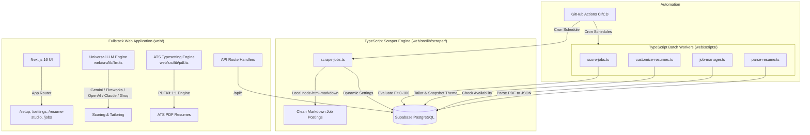

# JobTrack: Autonomous Job Scraper & AI Resume Studio

<div align="center">


-black.svg)


**An autonomous multi-platform job hunting, AI resume tailoring, and ATS typesetting platform.**

[Quick Start](#-quick-start) • [Daily Usage](#-daily-usage-day-2) • [Architecture](#-architecture) • [Features](#-core-features) • [Setup Wizard](#-setup-wizard-flow-setup) • [CLI & Commands](#-commands--scripts) • [AI Instructions](AGENTS.md)

<div style="margin-top: 12px;">

[-blue?style=for-the-badge)](https://github.com/anandanair/job-scraper/archive/refs/heads/main.zip)
[](https://vercel.com/new/clone?repository-url=https%3A%2F%2Fgithub.com%2Fanandanair%2Fjob-scraper&env=NEXT_PUBLIC_SUPABASE_URL,NEXT_PUBLIC_SUPABASE_ANON_KEY,SUPABASE_SERVICE_ROLE_KEY)

</div>

</div>

---

## 🌟 Core Features

- **Multi-Platform Scraper**: Resilient, rate-limited scraping for **LinkedIn** and **CareersFuture** with rotating user-agents, automatic exponential backoffs, and local HTML-to-Markdown conversion (zero LLM overhead).
- **Interactive 5-Step Setup Wizard**: Set up Supabase, test AI model credentials, configure target locations and job queries, upload and parse your resume, and auto-provision GitHub Actions secrets in minutes.
- **Master Resume Studio**: Dual-mode master resume editor (`Resume Content` + `Design & Style`) with live ATS persona switching, tag chip editors, and 1:1 pixel-calibrated PDF preview with page budget protections.
- **Universal LLM Engine**: Native support for **Google Gemini** (Gemini 2.5 Flash, 3 Flash Preview), **Fireworks AI**, **OpenAI**, **Anthropic Claude**, and **Groq**, with dynamic settings and quota/RPM controls stored in Supabase.
- **Automated GitHub Actions Pipeline**: Autonomous scheduled workflows scrape postings, evaluate resume suitability scores (0–100), generate job-tailored PDF resumes, and expire old postings.
- **Clean Fullstack Stack**: High-performance Next.js 16 (React 19, Tailwind CSS v4) fullstack web application, TypeScript automation workers, and a pure TypeScript scraping engine with native browser TLS impersonation.

---

## 🏗 Architecture



### System Boundaries
1. **Fullstack Web Application (`web/`)**:
   - Contains all user interface pages, REST API Route Handlers (`web/src/app/api/`), universal AI integrations (`web/src/lib/llm.ts`), ATS PDF typesetting (`web/src/lib/pdf.ts`), and scheduled batch tasks (`web/scripts/`).
   - All client-to-server operations run through Next.js route handlers.
2. **TypeScript Scraping Engine (`web/src/lib/scraper/` & `web/scripts/scrape-jobs.ts`)**:
   - Collects job postings from LinkedIn (via guest endpoints with `impit` browser TLS/JA4 impersonation) and CareersFuture (typed REST API).
   - Converts HTML descriptions to Markdown locally using `node-html-markdown` without consuming LLM quotas.
   - Dynamically loads search preferences directly from Supabase `app_settings`.
   - Eliminates Python runtime requirements, virtual environments, and pip packages completely.
3. **Single Source of Truth (`app_settings`)**:
   - Search queries, target locations, workplace filters, scraping sources, AI model choices, and rate limits are stored in the Supabase `app_settings` table and configured via the web UI.

---

## 🚀 Quick Start

Choose the easiest installation method for your setup:

### Method 1: 1-Line Quick Install (Zero Git / Zero Cloning Required)

Open your terminal and paste one command:

- **Windows (PowerShell)**:
  ```powershell
  irm https://raw.githubusercontent.com/anandanair/job-scraper/main/install.ps1 | iex
  ```
  *PowerShell checks Node.js, downloads JobTrack, installs dependencies, places a **JobTrack shortcut on your Desktop**, and opens `http://localhost:3000/setup`.*

- **macOS / Linux (Terminal)**:
  ```bash
  curl -fsSL https://raw.githubusercontent.com/anandanair/job-scraper/main/install.sh | bash
  ```

---

### Method 2: 1-Click ZIP Download (No Git Needed)

1. **[Download JobTrack (.zip)](https://github.com/anandanair/job-scraper/archive/refs/heads/main.zip)** and extract it to any folder.
2. Double-click **[`install.bat`](install.bat)** (Windows) or execute **[`./install.sh`](install.sh)** (macOS/Linux).
3. The installer configures dependencies, adds a **Desktop shortcut**, and automatically opens the browser setup wizard.

---

### Method 3: 1-Click Cloud Deployment (Zero Local Installation)

Don't want to install Node.js locally? Run the entire system serverless in the cloud for free:

[](https://vercel.com/new/clone?repository-url=https%3A%2F%2Fgithub.com%2Fanandanair%2Fjob-scraper&env=NEXT_PUBLIC_SUPABASE_URL,NEXT_PUBLIC_SUPABASE_ANON_KEY,SUPABASE_SERVICE_ROLE_KEY)

- **Next.js UI & REST APIs**: Hosted on Vercel.
- **Database & Storage**: Hosted on Supabase (PostgreSQL + Buckets).
- **Background Scrapers & AI Workers**: Autonomous cron execution via GitHub Actions.

---

## ☀️ Daily Usage (Day 2+)

Once installed, you never need to re-run the installer or re-install dependencies:

- **Windows**: Double-click the **JobTrack** icon on your Desktop, or double-click **[`start.bat`](start.bat)**.
- **macOS / Linux**: Run **[`./start.sh`](start.sh)** from the project directory.

The local web server starts instantly in a single window and opens **`http://localhost:3000`** in your browser.

---

## 🔄 Updating JobTrack

JobTrack keeps both your **code** and your **database schema** up to date:

- **Automatic on Startup**: Every time you launch via `start.bat` or `./start.sh`, JobTrack fetches the latest code from the primary repository (`upstream`), fast-forwards your local copy, and pushes the update to your GitHub fork so your cloud automation runs the same code. If you have uncommitted changes or a diverged branch, it warns you and starts anyway rather than breaking your install.
- **Automatic Fork Sync**: Your GitHub fork is synced with the primary repository daily by the `Sync Fork with Upstream` workflow, so your cloud automation (scraping, scoring, resume tailoring) always runs the latest code.
- **Automatic Database Updates**: Schema changes ship as versioned migrations and are applied automatically — both when you launch the app and before every cloud automation run. If your database predates the migration booster, a banner appears with a one-click SQL snippet to paste into your Supabase SQL Editor.
- **Manual 1-Click Updater**: Double-click **[`update.bat`](update.bat)** (Windows) or run **[`./update.sh`](update.sh)** (macOS/Linux) anytime to force an update. Unlike the launcher, this reports errors instead of continuing.
- *Note: User settings, AI configurations, and job data reside in your Supabase database and local `.env.local`, which are safely preserved across updates. Your data is never overwritten by an update.*

---

## 🛠 Manual Installation & Local Development (Developers)

If you prefer to configure the repository manually:

### 1. Clone the Repository
```bash
git clone https://github.com/anandanair/job-scraper.git
cd job-scraper
```

### 2. Install Dependencies
```bash
# Install application dependencies (Next.js, React, Tailwind, Scraper Engine, PDFKit)
npm run install:web
```

### 3. Setup Supabase Database
1. Create a free project at [Supabase](https://supabase.com).
2. Go to the **SQL Editor** (`>_` icon) in your Supabase dashboard.
3. Open [`supabase_setup/init.sql`](supabase_setup/init.sql), paste its entire contents, and click **Run**.
   - *This creates all tables (`jobs`, `base_resume`, `customized_resumes`, `resume_style_settings`, `app_settings`, `linkedin_geo_locations`), indexes, and triggers (PDFs are streamed dynamically on-the-fly via PDFKit, requiring 0 storage buckets).*

### 4. Configure Environment Variables
Create a `web/.env.local` file (only Supabase credentials required):
```env
NEXT_PUBLIC_SUPABASE_URL="https://<YOUR_PROJECT_ID>.supabase.co"
NEXT_PUBLIC_SUPABASE_ANON_KEY="sb_publishable_..."
SUPABASE_SERVICE_ROLE_KEY="sb_secret_..."
```
*(Note: All AI provider settings, API keys, search queries, and rate limits are managed in the Supabase `app_settings` table and configured via the interactive Setup Wizard or Settings UI.)*

Create an optional root `.env` file (if running workers from root outside web/):
```env
SUPABASE_URL="https://<YOUR_PROJECT_ID>.supabase.co"
SUPABASE_SERVICE_ROLE_KEY="sb_secret_..."
```

### 5. Start the Web App
```bash
npm run dev
```
Open [http://localhost:3000](http://localhost:3000) to view your dashboard or [http://localhost:3000/setup](http://localhost:3000/setup) to run the wizard.

---

## 🧙‍♂️ Setup Wizard Flow (`/setup`)

The web application includes an interactive 5-step onboarding wizard:

1. **Step 1: Database Setup**
   - Connect your Supabase Project URL and Service Role Key.
   - Run or verify table schema and storage buckets directly from the browser.
2. **Step 2: AI Engine Configuration**
   - Select your provider: **Google Gemini**, **Fireworks AI**, **OpenAI**, **Anthropic Claude**, or **Groq**.
   - Pick your desired model with intelligent auto-detection.
   - Test your API key with real-time latency and connectivity checks.
   - Interactive monthly budget calculator based on your expected scraping volume.
3. **Step 3: Job Preferences**
   - Search query tags (e.g., `Full Stack Engineer`, `AI Engineer`).
   - Location selector with built-in LinkedIn GeoID resolution (e.g., Singapore `102454443`, United States `103644278`, London `102257491`).
   - Job types (Full-time, Contract, Part-time, Internship) and workplace models (On-site, Hybrid, Remote).
   - Platform toggles: LinkedIn and Singapore CareersFuture.
4. **Step 4: Master Resume Studio**
   - Upload your master PDF resume (`resume.pdf`).
   - AI extracts text and parses it into structured JSON schema (contact info, summary, experience, skills, education, projects, certifications).
   - Review, edit, and preview ATS styling presets in real time.
5. **Step 5: GitHub Automation**
   - Provide a GitHub Personal Access Token (`repo` scope).
   - The wizard automatically encrypts secrets using **Tweetsodium** (libsodium) and uploads them directly to your GitHub repository secrets:
     - `SUPABASE_URL`
     - `SUPABASE_SERVICE_ROLE_KEY`
   - Enables background GitHub Actions workflows with one click.

---

## 🎨 Master Resume Studio (`/resume-studio`)

The built-in Resume Studio offers an end-to-end ATS resume authoring and styling workflow:

- **Dual-Mode Editor**:
  - **Resume Content**: Edit career experiences, custom bullet points, skills chip tags, degrees, certifications, and portfolio links.
  - **Design & Style**: Customize typography (Helvetica, Times-Roman, Courier), font scale (compact, normal, spacious), line height, page margins, header layouts, custom section order, section visibility, and accent colors.
- **1:1 Typesetting Engine (`web/src/lib/pdf.ts`)**:
  - Built with PDFKit for strict ATS-friendliness (machine-parseable text layers, standard system fonts, zero unreadable graphical artifacts).
  - Orphan heading prevention (widow/orphan rules keep section headings paired with their content across page breaks).
  - Sentence-level abbreviation preservation (`e.g.`, `i.e.`, `Ph.D.`, `U.S.`).
- **Live PDF Preview**: Real-time rendering inside the browser using React-PDF.

---

## 🤖 Automated GitHub Actions Workflows

Automated background jobs run via GitHub Actions on pre-configured schedules:

| Workflow File | Name | Schedule | Description |
| :--- | :--- | :--- | :--- |
| [`scrape_jobs.yml`](.github/workflows/scrape_jobs.yml) | **Daily Job Scraper** | Daily at 7:00 PM SGT (`0 11 * * *`) | Scrapes new postings from LinkedIn and CareersFuture. Matrix runner distributes search queries across parallel jobs. |
| [`score_jobs.yml`](.github/workflows/score_jobs.yml) | **Job Scorer** | Every 4 hours (`0 */4 * * *`) | TypeScript worker evaluates unscored jobs against candidate resume (0–100 score). |
| [`hourly_resume_customization.yml`](.github/workflows/hourly_resume_customization.yml) | **Resume Customization** | Every 4 hours (`30 */4 * * *`) | Generates job-specific tailored resumes for top-scoring jobs (`score >= 70`). |
| [`job_manager.yml`](.github/workflows/job_manager.yml) | **Daily Job Manager** | Daily at 1:00 AM SGT (`0 17 * * *`) | Verifies posting availability on LinkedIn and marks listings older than 30 days as expired. |

All workflows can also be manually dispatched at any time via the **Actions** tab in GitHub.

---

## 💻 Commands & Scripts

Run these commands from the repository root:

```bash
# --- Web Application & Development ---
npm run dev              # Start Next.js development server (http://localhost:3000)
npm run build            # Build Next.js application for production
npm run start            # Run production Next.js server
npm run install:web      # Install web application dependencies

# --- Job Scraper ---
npm run scrape           # Run TypeScript scraper using settings from Supabase (impit + cheerio)
npm run test:scraper     # Run diagnostic & parity tests on scraping engine
npm run scrape -- --source linkedin --query "Frontend Engineer" --limit 10

# --- TypeScript Automation Workers ---
npm run score            # Score unscored jobs against base resume
npm run customize        # Tailor custom resumes for top-matching jobs
npm run manage           # Verify job availability and expire stale postings
npm run parse-resume     # Parse resume.pdf into base_resume table
```

---

## 📁 Repository Structure

```
.
├── .github/workflows/          # Automated GitHub Actions CI/CD workflows
│   ├── scrape_jobs.yml         # Daily TypeScript job scraper
│   ├── score_jobs.yml          # TypeScript AI job scorer
│   ├── hourly_resume_customization.yml # TypeScript resume tailor
│   └── job_manager.yml         # TypeScript job status manager
├── memory/                     # Project Memory & Agent Knowledge Base
│   ├── context.md              # Living technical architecture, schema & APIs
│   ├── progress_latest.md      # Running monthly work log & progress tracker
│   └── archive/                # Historical monthly progress logs
├── supabase_setup/             # Database SQL Migrations
│   ├── init.sql                # Complete initial schema, RPCs, and storage buckets
│   ├── add_app_settings.sql    # App settings schema reference
│   └── resume_style_settings.sql # Resume style schema reference
├── web/                        # Next.js 16 Fullstack Application & TS Workers
│   ├── scripts/                # TypeScript batch worker scripts (run via tsx)
│   │   ├── customize-resumes.ts# Resume customization batch worker
│   │   ├── job-manager.ts      # Job expiration & active status checker
│   │   ├── parse-resume.ts     # Resume PDF parser
│   │   └── score-jobs.ts       # Job scoring batch worker
│   ├── src/
│   │   ├── app/                # App Router (Pages & REST API route handlers)
│   │   ├── components/         # React components (setup, jobs, resume-studio, etc.)
│   │   ├── lib/                # Core logic (llm.ts, pdf.ts, resumeParser.ts, supabase/)
│   │   ├── utils/supabase/     # Supabase server & client initializers
│   │   └── types.ts            # Shared TypeScript interfaces & types
│   ├── package.json            # Web dependencies & scripts
│   └── tsconfig.json
├── install.bat                 # 1-Click installer for Windows
├── install.ps1                 # 1-Line PowerShell installer for Windows
├── install.sh                  # 1-Click / 1-Line installer for macOS/Linux
├── start.bat                   # Instant daily launcher with auto-update (Windows)
├── start.sh                    # Instant daily launcher with auto-update (macOS/Linux)
├── update.bat                  # Dedicated 1-click updater for Windows
├── update.sh                   # Dedicated 1-click updater for macOS/Linux
├── package.json                # Monorepo root npm scripts
├── vercel.json                 # Vercel deployment configuration
├── AGENTS.md                   # AI Agent & Pair Programming Protocol
├── CLAUDE.md                   # Claude Code instructions
├── README.md                   # Project documentation
└── LICENSE                     # MIT License
```

---

## 🤖 Instructions for AI Coding Agents

If you are an AI coding assistant (Antigravity, Cursor, Claude Code, GitHub Copilot, Codex, etc.) working on this project:
- Refer to [`AGENTS.md`](AGENTS.md) for the operational protocol and core guardrails.
- Read [`memory/context.md`](memory/context.md) for the single source of truth on architecture, APIs, schema, and tech stack details.
- Log completed work in [`memory/progress_latest.md`](memory/progress_latest.md).

---

## 📄 License

This project is open-source and licensed under the [MIT License](LICENSE).
