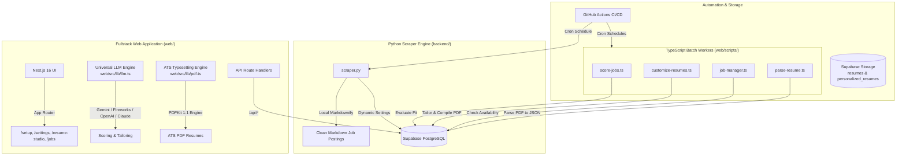

# JobTrack: Autonomous Job Scraper & AI Resume Studio

<div align="center">


-black.svg)


**A complete, unified monorepo for autonomous multi-platform job hunting, AI resume tailoring, and ATS typesetting.**

[Quick Start](#-quick-start-1-click-installer) • [Architecture](#-monorepo-architecture) • [Features](#-core-features) • [Setup Wizard](#-setup-wizard-flow) • [CLI & Commands](#-commands--scripts) • [AI Instructions](AGENTS.md)

</div>

---

## 🌟 Highlights

- **Multi-Platform Scraper**: Resilient, rate-limited scraping for **LinkedIn** and **CareersFuture** with rotating user-agents, automatic exponential backoffs, and local HTML-to-Markdown conversion (zero LLM overhead).
- **Interactive 5-Step Setup Wizard**: Set up Supabase, test AI model credentials, configure target locations and job queries, upload and parse your resume, and auto-provision GitHub Actions secrets in minutes.
- **Master Resume Studio**: Dual-mode master resume editor (`Resume Content` + `Design & Style`) with live ATS persona switching, tag chip editors, and 1:1 pixel-calibrated PDF preview with page budget protections.
- **Universal LLM Engine**: Native support for **Google Gemini** (Gemini 2.5 Flash, 3 Flash Preview), **Fireworks AI**, **OpenAI**, **Anthropic Claude**, and **Groq**, with dynamic settings and quota/RPM controls stored in Supabase.
- **Automated GitHub Actions Pipeline**: Autonomous scheduled workflows scrape postings, evaluate resume suitability scores (0–100), generate job-tailored PDF resumes, and expire old postings.
- **Unified Monorepo**: Frontend and backend are merged into a single cohesive repository—combining a lightweight Python scraper with a fullstack Next.js 16 application and TypeScript batch workers.

---

## 🏗 Monorepo Architecture



### Key Architectural Boundaries
1. **Fullstack Next.js App (`web/`)**:
   - Contains all web pages, REST API Route Handlers (`web/src/app/api/`), AI integrations (`web/src/lib/llm.ts`), ATS PDF generation (`web/src/lib/pdf.ts`), and scheduled batch tasks (`web/scripts/`).
   - **There is no separate Python REST API server (no FastAPI or Flask).** All client-to-server operations run through Next.js route handlers.
2. **Python Scraping Engine (`backend/`)**:
   - Solely responsible for scraping job portals (`backend/scraper.py`).
   - Converts HTML descriptions to Markdown locally using `markdownify` without consuming LLM quotas.
   - Dynamically loads search preferences directly from Supabase `app_settings`.
3. **Single Source of Truth (`app_settings`)**:
   - Search queries, target locations, workplace filters, scraping sources, AI model choices, and rate limits are stored in the Supabase `app_settings` table and configured via the web UI.

---

## 🚀 Quick Start (1-Click Installer)

The repository provides automated 1-click installers that verify prerequisites (Node.js 24 LTS recommended, Python 3.10+), install dependencies, start the dev server, and launch the setup wizard.

### Windows
Double-click [`install.bat`](install.bat) or run from PowerShell / Command Prompt:
```cmd
.\install.bat
```

### macOS / Linux
Run [`install.sh`](install.sh) from terminal:
```bash
chmod +x install.sh
./install.sh
```

Once running, your browser will automatically open **`http://localhost:3000/setup`** to complete the 5-step guided configuration.

---

## 🛠 Manual Installation & Local Development

If you prefer to configure the repository manually:

### 1. Clone the Repository
```bash
git clone https://github.com/anandanair/job-scraper.git
cd job-scraper
```

### 2. Install Dependencies
```bash
# Install web dependencies (Next.js, React, Tailwind, PDFKit, etc.)
npm run install:web

# Install scraper dependencies (Python 3.10+)
pip install -r backend/requirements.txt
```

### 3. Setup Supabase Database
1. Create a free project at [Supabase](https://supabase.com).
2. Go to the **SQL Editor** (`>_` icon) in your Supabase dashboard.
3. Open [`supabase_setup/init.sql`](supabase_setup/init.sql), paste its entire contents, and click **Run**.
   - *This creates all tables (`jobs`, `base_resume`, `customized_resumes`, `resume_style_settings`, `app_settings`, `linkedin_geo_locations`), indexes, triggers, and private storage buckets (`resumes`, `personalized_resumes`).*

### 4. Configure Environment Variables
Create a `web/.env.local` file:
```env
NEXT_PUBLIC_SUPABASE_URL="https://<YOUR_PROJECT_ID>.supabase.co"
NEXT_PUBLIC_SUPABASE_ANON_KEY="sb_publishable_..."
SUPABASE_SERVICE_ROLE_KEY="sb_secret_..."
LLM_API_KEY="AIzaSy..." # Or FIREWORKS_API_KEY, OPENAI_API_KEY, ANTHROPIC_API_KEY, GROQ_API_KEY
```

Create a `backend/.env` file (or root `.env`):
```env
SUPABASE_URL="https://<YOUR_PROJECT_ID>.supabase.co"
SUPABASE_SERVICE_ROLE_KEY="sb_secret_..."
```

### 5. Start the Web App
```bash
npm run dev
```
Open [http://localhost:3000](http://localhost:3000) to view your dashboard or [http://localhost:3000/setup](http://localhost:3000/setup) to run the wizard.

---

## 🧙‍♂️ Setup Wizard Flow (`/setup`)

The web application includes an interactive 5-step onboarding wizard:

1. **Step 1: Database Setup**
   - Connect your Supabase Project URL and Service Role Key.
   - Run or verify table schema and storage buckets directly from the browser.
2. **Step 2: AI Engine Configuration**
   - Select your provider: **Google Gemini**, **Fireworks AI**, **OpenAI**, **Anthropic Claude**, or **Groq**.
   - Pick your desired model with intelligent auto-detection.
   - Test your API key with real-time latency and connectivity checks.
   - Interactive monthly budget calculator based on your expected scraping volume.
3. **Step 3: Job Preferences**
   - Search query tags (e.g., `Full Stack Engineer`, `AI Engineer`).
   - Location selector with built-in LinkedIn GeoID resolution (e.g., Singapore `102454443`, United States `103644278`, London `102257491`).
   - Job types (Full-time, Contract, Part-time, Internship) and workplace models (On-site, Hybrid, Remote).
   - Platform toggles: LinkedIn and Singapore CareersFuture.
4. **Step 4: Master Resume Studio**
   - Upload your master PDF resume (`resume.pdf`).
   - AI extracts text and parses it into structured JSON schema (contact info, summary, experience, skills, education, projects, certifications).
   - Review, edit, and preview ATS styling presets in real time.
5. **Step 5: GitHub Automation**
   - Provide a GitHub Personal Access Token (`repo` scope).
   - The wizard automatically encrypts secrets using **Tweetsodium** (libsodium) and uploads them directly to your GitHub repository secrets:
     - `SUPABASE_URL`
     - `SUPABASE_SERVICE_ROLE_KEY`
   - Enables background GitHub Actions workflows with one click.

---

## 🎨 Master Resume Studio (`/resume-studio`)

The built-in Resume Studio offers an end-to-end ATS resume authoring and styling workflow:

- **Dual-Mode Editor**:
  - **Resume Content**: Edit career experiences, custom bullet points, skills chip tags, degrees, certifications, and portfolio links.
  - **Design & Style**: Customize typography (Helvetica, Times-Roman, Courier), font scale (compact, normal, spacious), line height, page margins, header layouts, custom section order, section visibility, and accent colors.
- **1:1 Typesetting Engine (`web/src/lib/pdf.ts`)**:
  - Built with PDFKit for strict ATS-friendliness (machine-parseable text layers, standard system fonts, zero unreadable graphical artifacts).
  - Orphan heading prevention (widow/orphan rules keep section headings paired with their content across page breaks).
  - Sentence-level abbreviation preservation (`e.g.`, `i.e.`, `Ph.D.`, `U.S.`).
- **Live PDF Preview**: Real-time rendering inside the browser using React-PDF.

---

## 🤖 Automated GitHub Actions Workflows

Automated background jobs run via GitHub Actions on pre-configured schedules:

| Workflow File | Name | Schedule | Description |
| :--- | :--- | :--- | :--- |
| [`scrape_jobs.yml`](.github/workflows/scrape_jobs.yml) | **Daily Job Scraper** | Daily at 7:00 PM SGT (`0 11 * * *`) | Scrapes new postings from LinkedIn and CareersFuture. Matrix runner distributes search queries across parallel jobs. |
| [`score_jobs.yml`](.github/workflows/score_jobs.yml) | **Job Scorer** | Every 4 hours (`0 */4 * * *`) | TypeScript worker evaluates unscored jobs against candidate resume (0–100 score). |
| [`hourly_resume_customization.yml`](.github/workflows/hourly_resume_customization.yml) | **Resume Customization** | Every 4 hours (`30 */4 * * *`) | Generates job-specific tailored resumes for top-scoring jobs (`score >= 70`). |
| [`job_manager.yml`](.github/workflows/job_manager.yml) | **Daily Job Manager** | Daily at 1:00 AM SGT (`0 17 * * *`) | Verifies posting availability on LinkedIn and marks listings older than 30 days as expired. |

All workflows can also be manually dispatched at any time via the **Actions** tab in GitHub.

---

## 💻 Commands & Scripts

Run these commands from the repository root:

```bash
# --- Web Application & Development ---
npm run dev              # Start Next.js development server (http://localhost:3000)
npm run build            # Build Next.js application for production
npm run start            # Run production Next.js server
npm run install:web      # Install web application dependencies

# --- Python Scraper ---
npm run scrape           # Scrape active platforms using settings from Supabase
python backend/scraper.py --source linkedin --query "Frontend Engineer" --limit 10

# --- TypeScript Batch Automation Workers ---
npm run score            # Score unscored jobs against base resume
npm run customize        # Tailor custom resumes for top-matching jobs
npm run manage           # Verify job availability and expire stale postings
npm run parse-resume     # Parse resume.pdf into base_resume table
```

---

## 📁 Repository Structure

```
.
├── .github/workflows/          # Automated GitHub Actions
│   ├── scrape_jobs.yml         # Daily Python job scraper
│   ├── score_jobs.yml          # TypeScript AI job scorer
│   ├── hourly_resume_customization.yml # TypeScript resume tailor
│   └── job_manager.yml         # TypeScript job status manager
├── backend/                    # Python Job Scraper Engine
│   ├── config.py               # Scraper network configs & fallback vars
│   ├── scraper.py              # Core multi-source scraper (LinkedIn & CareersFuture)
│   ├── supabase_utils.py       # Supabase client & dynamic app_settings loader
│   ├── user_agents.py          # User-Agent rotation pool
│   ├── requirements.txt        # Minimal Python dependencies
│   └── README.md               # Backend documentation
├── supabase_setup/             # Database SQL Migrations
│   ├── init.sql                # Complete initial schema, RPCs, and storage buckets
│   ├── add_app_settings.sql    # App settings schema reference
│   └── resume_style_settings.sql # Resume style schema reference
├── web/                        # Next.js 16 Fullstack Application & TS Workers
│   ├── scripts/                # TypeScript batch worker scripts (run via tsx)
│   │   ├── customize-resumes.ts# Resume customization batch worker
│   │   ├── job-manager.ts      # Job expiration & active status checker
│   │   ├── parse-resume.ts     # Resume PDF parser
│   │   └── score-jobs.ts       # Job scoring batch worker
│   ├── src/
│   │   ├── app/                # App Router (Pages & REST API route handlers)
│   │   ├── components/         # React components (setup, jobs, resume-studio, etc.)
│   │   ├── lib/                # Core logic (llm.ts, pdf.ts, resumeParser.ts, supabase/)
│   │   ├── utils/supabase/     # Supabase server & client initializers
│   │   └── types.ts            # Shared TypeScript interfaces & types
│   ├── package.json            # Web dependencies & scripts
│   ├── tsconfig.json
│   └── README.md               # Web documentation
├── install.bat                 # 1-Click installer for Windows
├── install.sh                  # 1-Click installer for macOS/Linux
├── package.json                # Monorepo root npm scripts
├── vercel.json                 # Vercel deployment configuration
├── AGENTS.md                   # AI Agent & Pair Programming Guidelines
├── CLAUDE.md                   # Claude Code instructions
├── .cursorrules                # Cursor IDE rules
├── README.md                   # Project documentation
└── LICENSE                     # MIT License
```

---

## 🤖 Instructions for AI Coding Agents

If you are working with an AI coding assistant (Cursor, Claude Code, GitHub Copilot, Antigravity, etc.), please refer to:
- [`AGENTS.md`](AGENTS.md) — Universal architectural rules, boundaries, and checklists.
- [`CLAUDE.md`](CLAUDE.md) — Claude Code specific instructions and commands.
- [`.cursorrules`](.cursorrules) — Cursor IDE guidance.
- [`.github/copilot-instructions.md`](.github/copilot-instructions.md) — Copilot context.

> [!IMPORTANT]
> **Monorepo Reminder**:
> - Job scoring, resume customization, PDF generation, and resume parsing are **TypeScript modules in `web/`**, not Python scripts.
> - The Python backend is solely for web scraping (`backend/scraper.py`).
> - There is no Python web server or REST API; all server endpoints are Next.js Route Handlers (`web/src/app/api/`).

---

## 📄 License

This project is open-source and licensed under the [MIT License](LICENSE).
