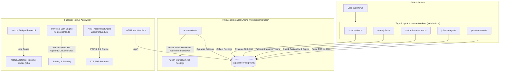

# JobTrack: System Architecture & Technical Context

> **Single Source of Truth for AI Coding Agents and Developers**  
> *Last Updated: October 2026*

---

## 1. System Overview

**JobTrack** is an autonomous job discovery, AI suitability evaluation, resume customization, and ATS typesetting platform. It consists of:
1. **TypeScript Scraping Engine (`web/src/lib/scraper/` & `web/scripts/scrape-jobs.ts`)**: Collects job listings from LinkedIn (via guest endpoints with `impit` native Chrome TLS/JA3/JA4 fingerprint impersonation) and CareersFuture (typed REST API) into Supabase PostgreSQL with local `node-html-markdown` conversion. Eliminates Python runtimes and pip dependencies completely.
2. **Fullstack Next.js Application (`web/`)**: Provides an interactive setup wizard, master resume studio, ATS visual theme designer, job dashboard, and REST API route handlers.
3. **TypeScript Batch Workers (`web/scripts/`)**: Autonomous worker processes for scraping, AI job scoring, custom resume generation, posting expiration checks, and master resume parsing.
4. **Supabase Backend**: Hosts application data (`jobs`, `base_resume`, `customized_resumes`, `resume_style_settings`, `app_settings`, `linkedin_geo_locations`). Storage buckets are deprecated in favor of on-demand in-memory PDF streaming.
5. **GitHub Actions CI/CD (`.github/workflows/`)**: Automates scheduled scraping, scoring, tailoring, and maintenance workflows on cron schedules.

---

## 2. Architectural Boundaries & Component Roles



### Critical Boundaries
1. **No Python Web Server**:
   - There is **no** Flask, FastAPI, Django, or Python HTTP server in this project.
   - All REST API endpoints and server routes are Next.js Route Handlers located under [`web/src/app/api/`](web/src/app/api/).
2. **Scraping Engine 100% in TypeScript**:
   - Built in TypeScript under [`web/src/lib/scraper/`](web/src/lib/scraper/) and executed via [`web/scripts/scrape-jobs.ts`](web/scripts/scrape-jobs.ts) (`npm run scrape`). It uses `impit` for browser TLS (JA3/JA4) impersonation on LinkedIn, `cheerio` for fast HTML parsing, and `node-html-markdown` for local Markdown conversion with zero LLM API cost.
   - Enforces a hard, non-overridable safety ceiling of 30 jobs/day per platform (`SAFE_MAX_SCRAPE_PER_SOURCE = 30`) to protect against guest endpoint rate-limits and IP blocking.
   - The project is fully unified in TypeScript with zero Python dependencies.
3. **TypeScript for Application Logic & Batch Workers**:
   - Job scoring, resume customization, PDF generation, job expiration, and resume parsing are written in TypeScript under [`web/scripts/`](web/scripts/) and [`web/src/lib/`](web/src/lib/).
   - `score-jobs.ts` prioritizes newest scraped listings first (`order("scraped_at", { ascending: false })`) to eliminate queue starvation and ensure fresh postings are evaluated immediately.
4. **Single Source of Truth for Configuration (`app_settings`)**:
   - All user preferences (search queries, locations, LinkedIn filters, scraping sources) and AI settings (provider, model, API keys, RPM limits, budget) are stored in the Supabase **`app_settings`** table.
   - The TypeScript scraper dynamically fetches these settings at startup via `loadScraperSettings(supabase)`.
   - The LLM caller in `web/src/lib/llm.ts` reads `app_settings` as the exclusive source of truth for AI configuration and credentials.

---

## 3. Directory Layout

```
.
├── .github/workflows/          # Automated GitHub Actions
│   ├── scrape_jobs.yml         # Daily TypeScript job scraper (7:00 PM SGT)
│   ├── score_jobs.yml          # TypeScript AI job scorer (every 4 hrs)
│   ├── hourly_resume_customization.yml # TypeScript resume tailor (every 4 hrs)
│   └── job_manager.yml         # TypeScript job status manager (daily)
├── memory/                     # AI & Engineering Knowledge Base
│   ├── context.md              # Living technical architecture and conventions (this file)
│   ├── progress_latest.md      # Active monthly changelog and task tracker
│   └── archive/                # Monthly archived progress logs
├── supabase_setup/             # Database SQL Schemas & Migrations
│   ├── init.sql                # Complete initial schema, RPCs, storage buckets
│   ├── add_app_settings.sql    # App settings schema reference
│   └── resume_style_settings.sql # Resume style schema reference
├── web/                        # Next.js 16 Fullstack App & Automation Workers
│   ├── scripts/                # TypeScript batch worker scripts (run via tsx)
│   │   ├── customize-resumes.ts# Resume customization batch worker
│   │   ├── job-manager.ts      # Job expiration & active status checker
│   │   ├── parse-resume.ts     # Resume PDF parser
│   │   └── score-jobs.ts       # Job scoring batch worker
│   ├── src/
│   │   ├── app/                # App Router (Pages & REST API route handlers)
│   │   │   ├── api/            # Server-side API endpoints
│   │   │   │   ├── base-resume/       # Base resume CRUD
│   │   │   │   ├── customized_resumes/# Tailored resume endpoints
│   │   │   │   ├── jobs/              # Job actions, rescore, customize
│   │   │   │   ├── resume-style/      # ATS style configuration
│   │   │   │   ├── settings/          # App settings & LLM test
│   │   │   │   └── setup/             # Setup wizard endpoints
│   │   │   ├── jobs/           # Job dashboard views (new, top-matches, tailored, applied, [id])
│   │   │   ├── resume-studio/  # Master Dual-Mode Resume Studio
│   │   │   ├── resume-style/   # ATS visual theme designer
│   │   │   ├── settings/       # AI provider & job preferences configuration
│   │   │   └── setup/          # 5-Step interactive onboarding wizard
│   │   ├── components/         # React components organized by feature
│   │   ├── lib/                # Core business logic (llm.ts, pdf.ts, resumeParser.ts, etc.)
│   │   ├── utils/supabase/     # Supabase client/server initializers
│   │   └── types.ts            # Shared TypeScript interfaces & types
│   ├── package.json            # Web application dependencies & worker scripts
│   └── tsconfig.json
├── install.bat                 # 1-Click installer for Windows
├── install.ps1                 # 1-Line PowerShell installer for Windows
├── install.sh                  # 1-Click / 1-Line installer for macOS/Linux
├── start.bat                   # Instant daily launcher with auto-update (Windows)
├── start.sh                    # Instant daily launcher with auto-update (macOS/Linux)
├── update.bat                  # Dedicated 1-click updater for Windows
├── update.sh                   # Dedicated 1-click updater for macOS/Linux
├── package.json                # Root monorepo scripts
├── vercel.json                 # Vercel deployment configuration
├── AGENTS.md                   # AI Agent operational protocol
├── CLAUDE.md                   # Claude Code lightweight pointer
└── README.md                   # Complete human-facing documentation
```

---

## 4. Database Schema (Supabase)

### Tables
1. **`jobs`**:
   - Scraped postings with `job_id`, `company`, `job_title`, `level`, `location`, `description` (Markdown), `status`, `is_active`, `resume_score`, `provider` (`linkedin` or `careers_future`), `is_interested`, `customized_resume_id`, `scraped_at`, `last_checked`.
2. **`base_resume`**:
   - Master resume profile parsed from user's master PDF. Fields: `id`, `name`, `email`, `phone`, `location`, `summary`, `skills` (text array), `education`, `experience`, `projects`, `certifications`, `languages`, `links` (JSONB), `parsed_at`.
3. **`customized_resumes`**:
   - Job-tailored resume variants. Links to `jobs.job_id` and contains tailored summary, tailored experiences, matched skills, generated timestamp, and `theme_config` (JSONB snapshot of active styling at application time).
4. **`resume_style_settings`**:
   - ATS theme configurations. Stores font family (`Helvetica`, `Times-Roman`, `Courier`), font scale (`compact`, `normal`, `spacious`), line spacing (`tight`, `normal`, `relaxed`), header layout, section order, margins, and accent colors.
5. **`app_settings`**:
   - Single-row table storing global application preferences:
     - AI provider (`gemini`, `fireworks`, `openai`, `anthropic`, `groq`), model name, API key, RPM rate limits, daily budget.
     - Search preferences: LinkedIn queries, GeoID, job type, date posted, CareersFuture queries, categories, active platforms.
     - Onboarding status: `setup_step`, `setup_completed`.
6. **`linkedin_geo_locations`**:
   - Pre-populated mapping of global locations to LinkedIn `geoId`s (e.g., Singapore `102454443`, United States `103644278`).

### Storage Architecture (On-Demand Streaming)
- **Supabase Storage Buckets (`resumes`, `personalized_resumes`)**: Fully deprecated.
- **On-Demand PDF Generation**: PDFs are compiled in-memory on demand via PDFKit (`/api/customized_resumes/[id]/pdf` and `/api/generate-resume`) in ~25ms. This ensures a single source of truth in PostgreSQL, zero storage costs/quota usage, no expiring signed URLs, and instant ATS rendering.

---

## 5. Technology Stack & Key Libraries

| Area | Technologies |
| :--- | :--- |
| **Frontend UI** | Next.js 16 (App Router), React 19, Tailwind CSS v4, Lucide React |
| **PDF Generation** | PDFKit (server-side 1:1 typesetting), React-PDF (client preview) |
| **Database & Auth** | Supabase (PostgreSQL, Row Level Security, Storage Buckets, `@supabase/ssr`) |
| **Job Scraper** | TypeScript, `impit` (Rust TLS/JA4 impersonation), `cheerio`, `node-html-markdown` |
| **AI LLM Engine** | Universal caller supporting Google Gemini, Fireworks AI, OpenAI, Anthropic, Groq |
| **Security & Secrets** | Tweetsodium (libsodium sealed-box encryption for GitHub Actions secrets) |
| **CLI Execution** | `tsx` for TypeScript worker execution without separate build steps |

---

## 6. Universal LLM Engine (`web/src/lib/llm.ts`)

- Dynamically selects provider and model from `app_settings` in Supabase.
- Supports:
  - **Google Gemini**: Gemini 2.5 Flash, Gemini 3 Flash Preview
  - **Fireworks AI**: Llama 3 models, DeepSeek models
  - **OpenAI**: GPT-4o, GPT-4o-mini
  - **Anthropic**: Claude 3.5 Sonnet, Claude 3.5 Haiku
  - **Groq**: Llama 3.3 70B, Mixtral
- Respects `llm_max_rpm` and `llm_request_delay_seconds` to prevent quota exhaustion.
- Automated HTTP 429 / quota exponential backoff retry inside `callLLM`.
- **Multi-Stage Resume Tailoring Pipeline (3-Call Agentic Flow)**:
  - **Stage 1 (The Strategist)**: `curateResumeStrategy` analyzes target role pain points, curates 8-15 matching skills, selects 1-3 best projects, defines anti-hallucination forbidden list, and creates role-by-role guidance.
  - **Stage 2 (The Copywriter)**: `writeTailoredResumeContent` crafts executive-grade ATS copy adhering to Google's XYZ formula (*Accomplished X as measured by Y by doing Z*) with active verbs, while preserving 100% of historical timeline (companies, titles, dates).
  - **Stage 2.5 (Deterministic Code Validation - 0 LLM Cost)**: `validateAndHealResume` verifies timeline integrity, caps projects at 3 for 2-page ATS ceiling, and self-heals non-tailored sections.
  - **Stage 3 (The Evaluator / Rescorer)**: `scoreJobWithResume` rescores job suitability against the tailored resume and marks `resume_score_stage = 'custom'`.
- Single source of truth: Supabase `app_settings.llm_api_key` (environment variables strictly contain Supabase connection keys only).

---

## 7. ATS PDF Typesetting Engine (`web/src/lib/pdf.ts`)

- Generates 1:1 pixel-accurate ATS-compliant PDFs using **PDFKit**.
- **ATS Rules Enforced**:
  - Pure text layer readable by automated applicant tracking parsers.
  - Standard system fonts: `Helvetica`, `Times-Roman`, `Courier`.
  - Widow and orphan prevention: Heading kept with at least the first block of content across page boundaries.
  - Abbreviation preservation: Prevents incorrect sentence splitting for `e.g.`, `i.e.`, `Ph.D.`, `U.S.`.
  - Dynamic page budgeting: Configurable typography scales (`compact`, `normal`, `spacious`) and margins to fit 1-page or 2-page targets.

---

## 8. Development & Operational Commands

All commands are executed from the repository root:

```bash
# --- Web Application ---
npm run dev              # Start Next.js development server (http://localhost:3000)
npm run build            # Build Next.js application for production
npm run start            # Run production Next.js server
npm run install:web      # Install web dependencies (npm --prefix web install)

# --- Job Scraper ---
npm run scrape           # Run TypeScript scraper using settings from Supabase (impit + cheerio)
npm run test:scraper     # Run diagnostic and live parity tests on scraping engine
npm run scrape -- --source linkedin --query "Frontend Engineer" --limit 10

# --- TypeScript Automation Workers ---
npm run score            # Evaluate unscored jobs against master resume (0-100 score)
npm run customize        # Tailor custom resumes for top matches (score >= 70)
npm run manage           # Verify job availability & expire listings >30 days
npm run parse-resume     # Parse master resume.pdf into base_resume table
```

---

## 9. Code Conventions & Rules for Changes

1. **Path Aliases**: In `web/`, use `@/*` to map to `web/src/*`.
2. **Components**:
   - Place components in `web/src/components/<feature>/`.
   - Client components must include `'use client';` at the top.
3. **Route Handlers**:
   - Endpoints belong in `web/src/app/api/<route>/route.ts`.
   - Return standard `NextResponse.json(...)`.
   - Use `createSupabaseServerClient()` or `createSupabaseStaticClient()` from `@/utils/supabase/server`.
4. **Environment Variables**:
   - `web/.env.local` (or root `.env`): `NEXT_PUBLIC_SUPABASE_URL`, `NEXT_PUBLIC_SUPABASE_ANON_KEY`, `SUPABASE_SERVICE_ROLE_KEY`.

